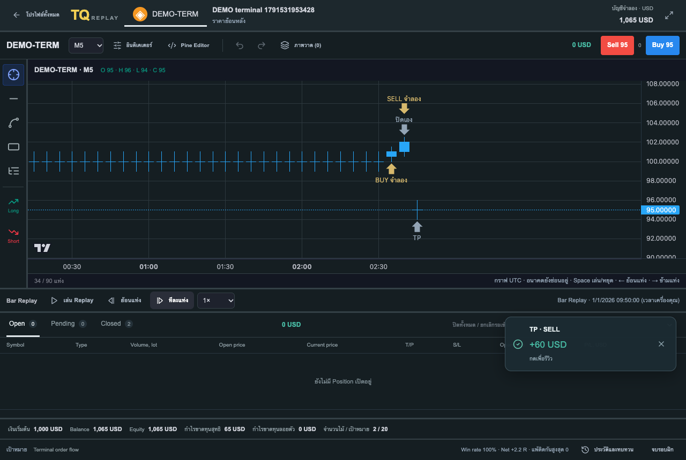

# TradeQuest Backtest

A standalone, local-first manual trading simulator. Create a practice profile, replay historical candles or real quotes, place simulated positions, and optionally review your trades. This application sends no broker orders.



## Start locally

Install Node.js 20.9+ with pnpm 10, Python 3.11+, and [uv](https://docs.astral.sh/uv/). From the repository root:

```bash
pnpm install --frozen-lockfile
uv sync --project apps/api --extra dev --locked
bash scripts/dev.sh
```

Open **http://localhost:3003**. The local API runs on **127.0.0.1:8790**. Stop both with Ctrl+C. These ports and the database are independent from TradeQuest.

- Practice database: `data/backtest.sqlite3`; API key: `data/local.key` (server only).
- `bash scripts/dev.sh --demo` uses a separate demo database.
- Optional environment variables: `TQ_WEB_PORT`, `TQ_API_PORT`, `TQ_DATA_DIR`.
- The app is local only. Login, multi-user cloud sync, public hosting and MT5 integration are not included.

## Practice flow

1. Create a profile with a name, starting capital, symbol/dataset, trade target and practice goal. New profiles randomly select a chart start; Load resumes the saved clock.
2. Draw trend lines, rectangles, horizontal levels or Fibonacci. Add indicators yourself, including supported Pine v5/v6 scripts through PineTS. The chart starts without indicators.
3. Use Buy/Sell to open price and lot settings, or drag a Long/Short position on the chart and right-click its settings. There is **no required entry reason or emotion**.
4. Play/Pause, choose speed, skip a bar or change timeframe. Real tick datasets replay their actual ordered Bid/Ask quotes; CSV datasets replay bars without invented ticks. Rewinding cancels open/pending simulated positions and preserves closed results.
5. Open several positions, see live floating P/L, close each with × on the chart/table, or close part of its volume. The terminal separates **Open / Pending / Closed**.
6. TP, SL and manual exits show a toast with P/L; playback continues unless the user pauses or the dataset ends. Click the toast to review, or use Review in Closed later. No review modal opens automatically.

All displayed funds and trades are simulated. Point value and currency are user-defined. This simulator does not model broker margin, swaps, queue/depth or execution latency. PineTS is an independent runtime; this is not the official TradingView compiler or an Exness application.

## Market data

Create demo candles in the app or import OHLC CSV. For BTCUSD/XAUUSD quotes:

```bash
python3 scripts/download_ticks.py --year 2025 --symbols BTCUSD XAUUSD --workers 4
PYTHONPATH=apps/api apps/api/.venv/bin/python scripts/import_tick_archives.py --year 2025
```

Initialize the local database first by starting the app once. Market archives, tick stores, profiles, private indicators and keys stay in ignored `data/`; they are **not** bundled with the repository. See [Tick Replay](docs/TICK_REPLAY_TH.md) for provider, price scale, gaps and fill rules.

To copy your existing local Backtest state from TradeQuest, stop the standalone app and use an empty destination:

```bash
PYTHONPATH=apps/api apps/api/.venv/bin/python scripts/import_tradequest.py \
  --source /path/to/TradeQuest
```

The helper snapshots the source database read-only, copies Backtest profiles/results, datasets, referenced tick stores and saved Pine versions, and refuses to overwrite populated destinations. Account secrets, Journal, MT5 bridge state and screenshots are excluded. The source stays intact. Imported private state is never staged or published.

## Development

- `apps/web/`: Next.js terminal, drawing tools, isolated Pine worker.
- `apps/api/`: FastAPI replay engine and four SQLite tables.
- `scripts/`: local launcher, market import/download, isolated testing and migration.
- `docs/`: Pine/drawing/data guides and authored demo screenshots.

```bash
bash scripts/test.sh
TQ_E2E_DEV=1 pnpm --dir apps/web test:e2e
```

Tests use only isolated demo databases on 3004/8791 (production) or 3005/8792 (development). See [CONTRIBUTING.md](CONTRIBUTING.md), [verification](docs/VERIFICATION.md), [Pine editor](docs/PINE_EDITOR_TH.md), and [drawing tools](docs/UX_DRAWING_TH.md).

## License

AGPL-3.0-only; see [LICENSE](LICENSE) and [third-party notices](THIRD_PARTY_NOTICES.md). PineTS dependency version and upstream notices are retained. Lightweight Charts' attribution logo and Apache license are retained. The repository contains complete application source, dependency lockfiles and build/test scripts; personal Pine scripts and market data are not distributed.
