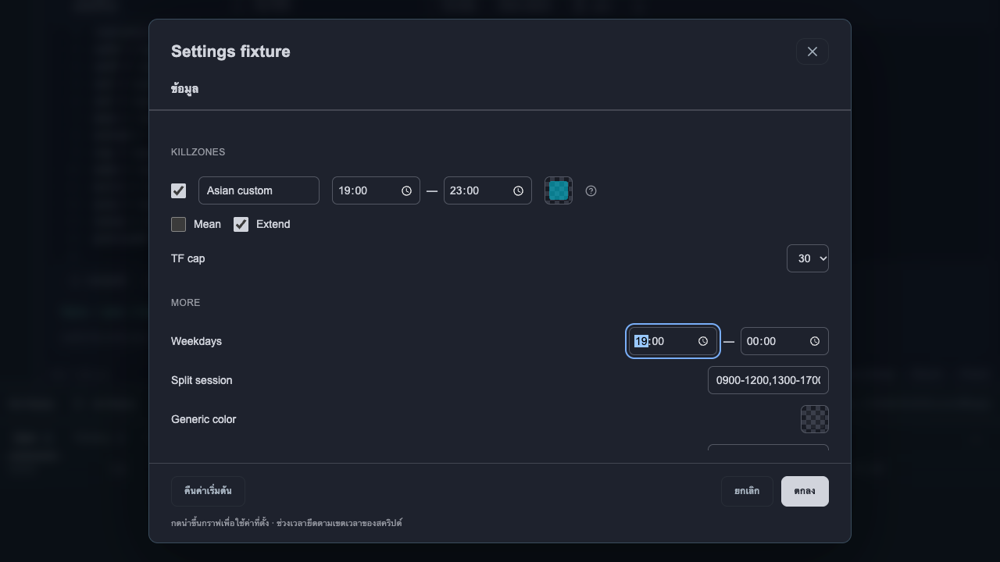
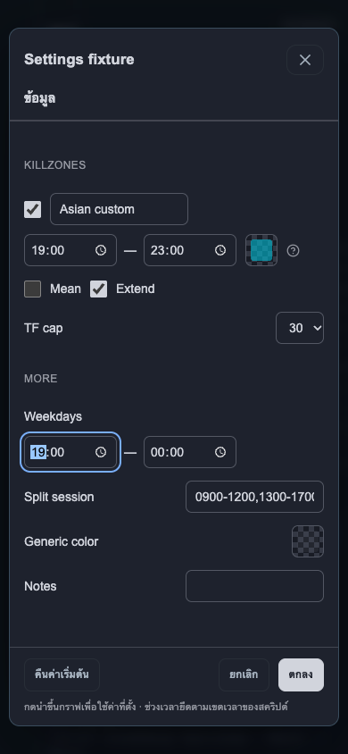

# Pine Editor ใน Backtest

เปิดโปรไฟล์ Backtest → **Pine Editor** บนแถบกราฟ วางโค้ด `//@version=5` หรือ `//@version=6` (มีคอมเมนต์ลิขสิทธิ์ก่อนหน้าได้) และประกาศ `indicator()` หรือเลือกตัวอย่าง EMA/MACD จากนั้นกด **ตรวจและรัน** ปุ่ม **Inputs** เปิดหน้าต่างปรับค่าที่ประกาศด้วย `input.*` กด **นำขึ้นกราฟ** เพื่อบันทึกและแสดงอินดิเคเตอร์ ปรับโค้ด/Inputs แล้วกด **อัปเดตบนกราฟ** หากกำลังแก้รายการเดิม หรือเพิ่มอีกชุดจากสคริปต์ใหม่ได้ รวมอินดิเคเตอร์เดิมและ Pine สูงสุด 8 รายการ

**บันทึกเวอร์ชัน** สร้างเวอร์ชันใหม่ ไม่เขียนทับเวอร์ชันเก่า เลือกสคริปต์จาก **คลัง Pine ของฉัน** และเลือกเวอร์ชันที่ต้องการได้ ปุ่มลบจากคลังนำออกจากรายการ แต่รักษาโค้ดที่ใช้ในรอบฝึกและเทรดเดิมไว้ เมื่อต้องการลบออกจากกราฟ เปิด **อินดิเคเตอร์** แล้วลบรายการนั้น ส่วนโค้ดที่ยังไม่บันทึกจะหายเมื่อปิด Editor

นำเข้า `.pine`/`.txt` ได้ไม่เกิน 40,000 ตัวอักษร หรือส่งออกโค้ดปัจจุบันเป็น `.pine` ข้อมูลคลังและโค้ดบันทึกอยู่ในฐานข้อมูลเฉพาะเครื่อง ไม่ส่งสคริปต์ไป compile ที่ TradingView และไม่อยู่ใน Git

## ตั้งค่า Inputs

หน้าต่างใช้ชื่ออินดิเคเตอร์และจัดหัวข้อ/แถวตาม `group` กับ `inline` ในสคริปต์ ช่องที่ระบุ title ว่างจะไม่แสดงชื่อตัวแปรให้รกหน้าจอ แต่ยังมีชื่อสำหรับการเข้าถึง Checkbox อยู่ข้างข้อความ ช่วงเวลาแบบหนึ่งช่วงแยกเป็นเวลาเริ่ม/สิ้นสุด และสีมี palette พร้อมความโปร่งใสบนพื้นตาราง รูปแบบ session ที่มีหลายช่วงยังแก้ไขเป็นข้อความเต็มได้ โดยรักษาวันในสัปดาห์และช่วงข้ามคืนไว้

**ตกลง** รับค่าที่แก้เข้า Editor แล้วกด **นำขึ้นกราฟ/อัปเดตบนกราฟ** เพื่อใช้จริง **ยกเลิก**, ปุ่มปิด และ Escape ทิ้งการแก้ในหน้าต่าง **คืนค่าเริ่มต้น** คืนค่าตาม source เฉพาะร่างจนกดตกลง การตั้งค่าสีมีปุ่มยกเลิกแยกอีกชั้น ค่าเวลาไม่ถูกแปลง timezone อัตโนมัติและยังยึดตามสคริปต์ ไม่มีแท็บรูปแบบ/การแสดงผลที่ยังใช้ไม่ได้

## ขอบเขตที่รองรับ

- ใช้ **PineTS 0.11.0** ซึ่งเป็น runtime อิสระที่รับโค้ด Pine v5/v6 ไม่ใช่ compiler ของ TradingView; ยังไม่รับประกันผลเทียบเท่า TradingView ทุก API
- แสดง `plot()` แบบเส้น/เส้นขั้นบันได/histogram/columns และ `hline()` ได้ บนกราฟหลัก (`overlay=true`) หรือช่องแยก รองรับคำนวณจาก OHLCV, `ta.*` ที่ runtime รองรับ, ตัวแปร/`var` และ Inputs
- แสดง `box.*`, `line.*`, `label.*` และ `bgcolor()` บนกราฟหลักได้ รวมถึงการแก้ไข/ลบวัตถุจากสคริปต์; วัตถุจะขยับตามแพน/ซูม/เปลี่ยน TF และเป็นผลอินดิเคเตอร์แบบอ่านอย่างเดียว แยกจากเครื่องมือวาดมือ รูปทรง label พิเศษ การจัดข้อความซับซ้อน และ tooltip ยังไม่เทียบเท่า TradingView
- ยังไม่รองรับ `request.*`/MTF ภายในสคริปต์, `indicator(timeframe=...)`, imports/libraries, strategy, alerts, drawings ใน pane แยก, tables/fills, bar colors, shapes/candles และ plot offset/show_last การเรียกที่ยังไม่รองรับจะแสดงข้อผิดพลาด แทนการปล่อยให้สัญญาณเก่าค้าง
- คำนวณจากหน้าต่างแท่งที่ API เปิดเผยเท่านั้น **สูงสุด 2,000 แท่ง** ไม่ใช่ประวัติเต็มปีในการคำนวณครั้งเดียว `bar_index` และค่า `var` เริ่มต้นใหม่ที่ต้นหน้าต่าง ค่าที่ต้องการประวัติยาวกว่านี้อาจต่างจาก TradingView
- Tick ใช้ราคา OHLC ที่กำลังก่อตัวและเวลาจำลองของ Replay สำหรับ `barstate.isconfirmed`/`timenow` คำนวณใหม่จากหน้าต่างทุกครั้งเพื่อ rollback `var` การเปลี่ยน TF/ย้อนจะไม่ใช้แท่งอนาคต ผลคำนวณที่มาช้าจากก่อนย้อนถูกทิ้ง อินดิเคเตอร์ทำงานเบื้องหลัง อาจตามภาพราคาเล็กน้อยเมื่อใช้สคริปต์หนัก
- สคริปต์ยาวไม่เกิน 40,000 ตัวอักษร; 0–16 plots ต่อสคริปต์ (สคริปต์วาดอย่างเดียวใช้ได้); สูงสุด 1,500 วัตถุ, 32,000 แถบ bgcolor และ 100 Inputs; จำกัดจำนวนวนลูปต่อ runtime และหยุด Worker เมื่อเกิน 5 วินาที ข้อผิดพลาดให้แก้สคริปต์แล้วนำขึ้นกราฟใหม่
- `barstate.isnew`/`isrealtime`, `varip` และรายละเอียด API อื่นที่ยังไม่ได้ทดสอบอาจต่างจาก TradingView; ไม่อ้างว่า runtime เทียบเท่าทุกกรณี
- ทดสอบใน Chrome ทั้ง production และ development/React StrictMode รวม viewport มือถือ ยังไม่ได้ทดสอบเครื่อง iPhone/Safari จริง หรือ compile เทียบใน TradingView

## ข้อมูลและความปลอดภัย

คลังใช้ `settings` เดิม (`pine-script:<uuid>`) เก็บเวอร์ชัน immutable, SHA-256, runtime version และวันที่สร้าง ไม่ต้องเปลี่ยน schema หรือ reset ฐาน ข้อมูลที่นำขึ้นกราฟและ `decision.indicators` ก่อนเข้า Position จำลองเก็บโค้ด/เวอร์ชัน/Inputs ที่ใช้จริงไว้ แก้คลังภายหลังไม่เปลี่ยนเทรดเก่า

รันใน Blob Worker ภายใน iframe แบบ opaque origin (`sandbox=allow-scripts` ไม่มี `allow-same-origin`) ด้วย CSP `connect-src 'none'` จึงไม่ใช้ origin/storage ของแอปและไม่เปิด market provider หรือ API ซื้อขาย เรียกสคริปต์ผ่าน structured messages เฉพาะชุดข้อมูลที่เปิดเผย หน้าจอไม่ใช้ `eval` กับโค้ดผู้ใช้ และเซิร์ฟเวอร์เก็บโค้ดเป็นข้อความเท่านั้น

## Dependency license

แอป standalone นี้เผยแพร่ซอร์สภายใต้ AGPL-3.0-only พร้อม LICENSE และ THIRD_PARTY_NOTICES.md ใช้ PineTS 0.11.0 ตาม dependency lockfile โดยเก็บ header และ license ของ runtime ไว้ สคริปต์ Pine ส่วนตัวและคลังเวอร์ชันอยู่ในฐานข้อมูล Local ที่ Git ไม่ติดตาม ไม่รวมสคริปต์ของผู้ใช้หรือผู้ให้บริการอินดิเคเตอร์ไปกับ repo
