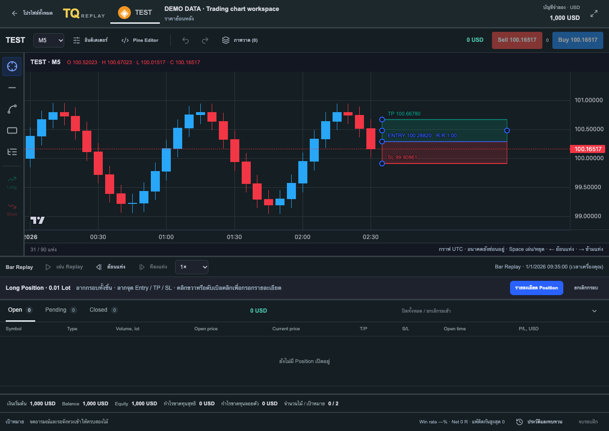
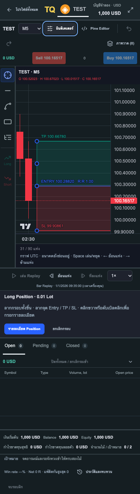
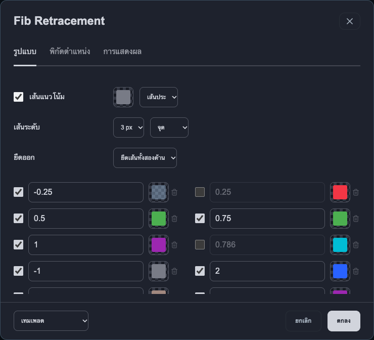
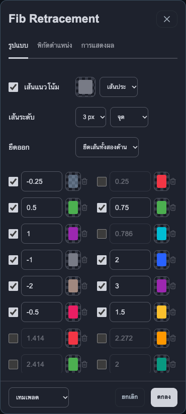
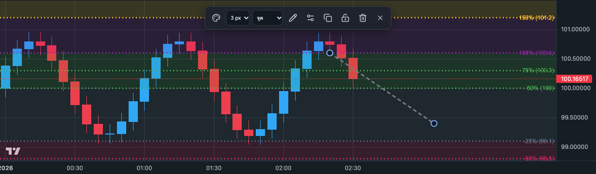
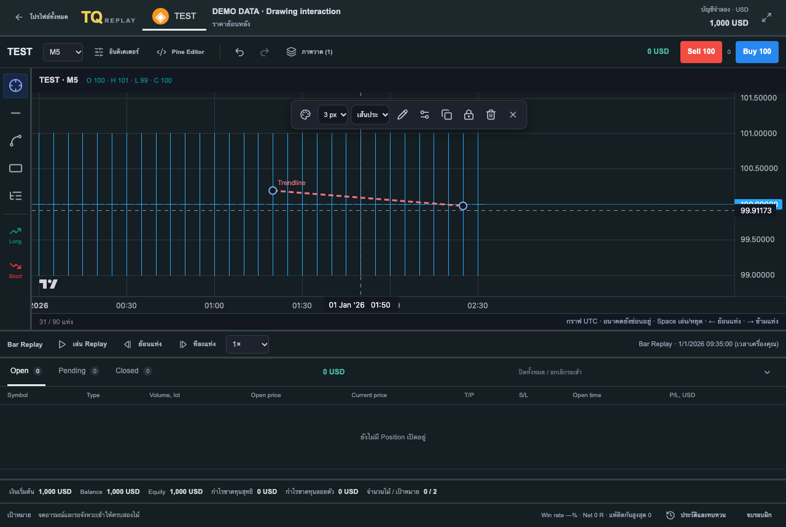
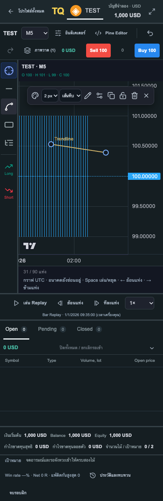

# วาดกราฟและการเคลื่อนไหวของหน้าจอ

## วาดและจัดการภาพวาด

1. เลือก Trendline, Zone / OB หรือ Fibo จากแถบเครื่องมือด้านซ้าย
2. แตะจุดแรกบนกราฟ จะเห็นจุดจับทันที เลื่อนเมาส์เพื่อดูภาพวาดตัวอย่างก่อนวางจุดปลาย บนจอสัมผัสแตะจุดปลายอีกครั้ง
3. เมื่อวาดเสร็จ ระบบกลับไปเครื่องมือเลื่อนกราฟ และเลือกภาพวาดใหม่ให้พร้อมแก้ไข
4. ลากบริเวณเส้นหรือกรอบเพื่อย้ายทั้งภาพวาด ลากจุดจับเพื่อปรับปลายทีละจุด กล่องมีจุดจับ 8 จุดทั้งมุมและขอบ แนวรับ/ต้านใช้จุดเดียวและวางด้วยการแตะครั้งเดียว
5. แตะภาพวาดที่บันทึกไว้ หรือคลิกขวาบนภาพวาด เพื่อเปิดแถบจัดการ เลือกสี ความหนา เส้นทึบ/ประ/จุด ชื่อ ล็อก หรือถังขยะได้

การล็อกป้องกันการลากตำแหน่ง แต่ยังปลดล็อก เปลี่ยนสไตล์ หรือลบได้ จุดจับมีพื้นที่แตะกว้างกว่าขนาดวงกลมที่เห็นเพื่อให้ใช้นิ้วง่ายขึ้น การลากเป็นการเปลี่ยนภาพบนเครื่องทันที บันทึกเมื่อปล่อยมือ ไม่ส่งคำขอทุกครั้งที่เมาส์หรือนิ้วขยับ การแก้สี/ความหนา/ชื่อ/ล็อกบันทึกแยกเมื่อยืนยัน หากบันทึกไม่สำเร็จ กลับมาแสดงข้อมูลที่บันทึกไว้และแสดงข้อผิดพลาด

- **Esc** ยกเลิกภาพวาดที่ยังไม่เสร็จ หรือยกเลิกการเลือก
- **Delete / Backspace** ลบภาพวาดที่เลือก ขณะไม่ได้พิมพ์ในช่องกรอก
- **Enter** เลือกภาพวาดที่ได้รับโฟกัสจากคีย์บอร์ด

ภาพวาดยึดกับเวลาและราคา เลื่อน/ซูมกราฟแล้วภาพวาดตามกราฟ เปลี่ยน TF แล้วจุดอ้างอิงยังอยู่ โดยใช้ตำแหน่งต่อเนื่องระหว่างแท่งของ TF ปัจจุบัน วางหรือย้ายได้ในพื้นที่ว่างด้านขวาและนอกช่วงแท่งที่แสดง โดยไม่ได้เปิดเผยราคาอนาคต การเริ่มวาดหรือแก้ภาพวาดจะหยุด Replay ก่อน กราฟและอินดิเคเตอร์เดิมยังอยู่ ไม่มีการสร้าง pane ใหม่จากการแก้ภาพวาด

## Chart workspace แบบ TradingView (2026-10-08)

- เมื่อเข้าโปรไฟล์ Backtest จะเปิดพื้นที่ฝึกกราฟเต็มความกว้าง แถบ Symbol/TF/อินดิเคเตอร์อยู่บนสุด เครื่องมือวาดเป็นไอคอนด้านซ้าย และ Play/Pause/ความเร็ว/ย้อน/ข้ามแท่งอยู่ใต้กราฟ สรุปบัญชีฝึกกับประวัติอยู่ด้านล่าง กลับหน้ารายการโปรไฟล์ได้จากปุ่มบนซ้าย
- วางภาพวาดในพื้นที่ว่างได้ จุดไม่กระโดดทีละแท่ง ลากกล่องทั้งชิ้นเพื่อย้าย; ลากขอบเพื่อปรับด้านเดียว หรือลากมุมเพื่อปรับสองด้าน เส้นและ Fibo ย้ายทั้งชิ้นหรือปรับจุดปลายได้
- แถบจัดการมีสี ความหนา รูปแบบเส้น ชื่อ ล็อก ทำสำเนา และลบ ดับเบิลคลิกภาพวาดหรือเลือกปุ่มรายละเอียดเพื่อแก้ชื่อ/เวลา/ราคาใน Modal; ปุ่มภาพวาดด้านบนเปิดรายการพร้อมลบใน Modal
- Undo/Redo ด้านบนย้อนได้ 50 การแก้ภาพวาดในรอบที่เปิดหน้านี้ และยังส่งบันทึกไปโปรไฟล์ตาม revision จริง Undo/Redo ไม่ย้อนราคา ผลเทรด หรืออินดิเคเตอร์ รายการย้อนแก้เริ่มใหม่เมื่อออกจากโปรไฟล์; ภาพวาดที่บันทึกไว้ยังอยู่
- กรอบ Long/Short ก่อนเข้าไม้ลากพื้นที่สีเพื่อย้ายทั้งกรอบได้สองแกน ลากจุด TP/SL/Entry เพื่อปรับราคา และลากจุดกลางขอบซ้าย/ขวาเพื่อปรับความกว้าง คลิกขวาหรือดับเบิลคลิกกรอบเปิด Modal ตัวเลข/Lot/เหตุผลเข้าไม้/อารมณ์ ยังต้องกรอกเหตุผลและอารมณ์ครบก่อนเปิด Position จำลอง
- เปลี่ยน TF หรือเพิ่มอินดิเคเตอร์ได้ระหว่างวางกรอบ เลือกเครื่องมือวาดเพื่อวาดทับบนกราฟได้; กลับเครื่องมือเลื่อนกราฟเพื่อแก้กรอบ Position ต่อ กรอบที่เปิด Position แล้วเป็นการแสดงหลักฐานของไม้จำลอง ไม่เปลี่ยนราคาที่ fill ไปแล้ว
- พิกัดกรอบ Position บันทึกแยกเป็น `decision.position_drawing` สำหรับไม้ใหม่ ตำแหน่งแนวนอนเป็นภาพประกอบ; ไม่ใช่เวลาส่งคำสั่งหรือเวลาที่ fill ไม้เก่าใช้เวลาเข้าเป็นจุดอ้างอิงตามเดิม

อ้างอิงพฤติกรรมจากเอกสาร [Rectangle](https://www.tradingview.com/support/solutions/43000516984-rectangle-drawing-tool/) และ [Long Position](https://www.tradingview.com/support/solutions/43000517002-long-position-drawing-tool/) ของ TradingView และใช้ [logical coordinates ของ Lightweight Charts](https://tradingview.github.io/lightweight-charts/docs/api/interfaces/ITimeScaleApi) เพื่อจัดตำแหน่งอิสระ โค้ด overlay เป็นของ TradeQuest Backtest; ยังมีเฉพาะเครื่องมือวาดและอินดิเคเตอร์ที่แอปรองรับ เครื่องมือทุกชนิดของ TradingView ยังไม่ได้รวมทั้งหมด ส่วน PineTS v6 ที่เพิ่มภายหลังมีขอบเขตตาม [PINE_EDITOR_TH.md](PINE_EDITOR_TH.md)

## ตั้งค่า Fib Retracement

ดับเบิลคลิก Fibo หรือเลือกภาพวาดแล้วกดปุ่มตั้งค่า เปิด Modal 3 แท็บ:

- **รูปแบบ**: เปิด/ปิดระดับ แก้เลขตั้งแต่ -100 ถึง 100 เพิ่ม/ลบได้ 1–32 ระดับ เลือกสีและความโปร่งใสแยกแต่ละระดับหรือใช้สีเดียว ปรับเส้นแนวโน้ม ความหนา/เส้นทึบ/ประ/จุด ยืดซ้าย/ขวา/ทั้งสองด้าน พื้นหลังพร้อมความทึบ กลับสถานะ ราคา ระดับแบบมูลค่า/เปอร์เซ็นต์ ตำแหน่งป้าย/ชื่อ และขนาดตัวอักษร
- **พิกัดตำแหน่ง**: เปลี่ยนชื่อ ราคา และเวลา UTC ของจุดทั้งสอง จุดยังลากหรือย้ายทั้งภาพวาดได้ตามเดิม
- **การแสดงผล**: เลือก TF ที่แสดงภาพวาด ถ้าซ่อนไว้ เปิดปุ่ม **ภาพวาด** ด้านบนแล้วกด **ตั้งค่า** ของ Fibo นั้นเพื่อแก้กลับได้

ค่าเริ่มต้นของ Fibo ใหม่ใช้ระดับตามภาพตัวอย่าง: 0, 0.25, 0.5, 0.75, 1, -1, 2, -2, 3, -0.5, 1.5 และมีระดับอื่นที่ยังไม่เปิดให้เลือก เทมเพลตมีสองแบบ: ระดับตามภาพตัวอย่าง และ 0/50/100; ยังไม่มีคลังเทมเพลตส่วนตัว การเลือกเทมเพลตเปลี่ยนเฉพาะค่ารูปแบบในหน้าต่าง ไม่เปลี่ยนพิกัด

**ตกลง** บันทึกทั้งหมดครั้งเดียวและ Undo/Redo ได้ **ยกเลิก / X / Escape** ทิ้งค่าที่ยังไม่ได้บันทึก ตัวเลือกสีเปิดเป็นหน้าต่างย่อยและมีการยกเลิกของตัวเอง ค่าเก็บแยกใน `drawing.fibo` ของแต่ละภาพวาด เปิดโปรไฟล์กลับมาได้ ไม่ต้อง migration/reset ฐานข้อมูล Fibo เก่าที่ไม่มี `fibo` ยังคง 0/50/100 สีเดียวและระยะเส้นเดิม จนกดยืนยันแก้ไขเอง หลักฐานภาพวาดก่อนเข้าไม้ใน decision ไม่เปลี่ยนตามการแก้ภายหลัง

ราคาแต่ละระดับคำนวณจากราคาจุดแรก + (ราคาจุดที่สอง − ราคาจุดแรก) × ระดับ; กลับสถานะสลับราคาจุดทั้งสองในการคำนวณโดยไม่ย้ายพิกัดจุดจับ การแปลงราคาเป็นพิกัดใช้ price scale ของกราฟ ไม่ใช้สัดส่วนระยะพิกเซล

## หน้าจอ

ใช้ [Motion for React](https://motion.dev/docs/react) กับการเปลี่ยนหน้าและการเปิด/ปิดฟอร์มหลัก หน้าต่างใช้ spring ที่สั้นและนุ่ม ปุ่มมีการตอบสนองเมื่อกด การ์ดและหน้าต่างมีมุมโค้งขึ้น การเปลี่ยนหน้ามี animation กราฟสั้น ๆ ส่วนการเปิดโปรไฟล์/รอข้อมูลแสดง loader จนคำขอเสร็จ โดยไม่เปลี่ยนความเร็วของตลาดจำลองหรือเล่น animation บนราคาที่คำนวณแล้ว

หากระบบปฏิบัติการตั้ง **Reduce Motion / ลดการเคลื่อนไหว** แอปจะลดการเคลื่อนไหวตกแต่งและคงการลากภาพวาดให้ตอบสนองโดยตรง

## ข้อมูลและการตรวจ

เพิ่ม `color`, `line_width`, `line_style`, `locked` ใน JSON ภาพวาดเดิม โดยมีค่าเริ่มต้นสำหรับรายการเก่า ไม่ต้อง migration หรือ reset ฐานข้อมูล ประวัติเทรด, Setup/version และ decision snapshot ที่บันทึกไว้ไม่ถูกแก้จากการเปลี่ยนสไตล์ภาพวาด

ตรวจด้วยข้อมูล DEMO แยก: preview ก่อนจุดที่สอง, ลากปลาย, ย้ายทั้งเส้น, สี/ความหนา/เส้นประ, ล็อก, ลบ, เปิดโปรไฟล์กลับมา, การลากด้วย touch events ใน Chrome emulation, Delete/Escape, reduced motion และ loader ที่รอข้อมูลจริง ผลรวมล่าสุดดู [VERIFICATION.md](VERIFICATION.md) และ [REPLAY_VERIFICATION.md](REPLAY_VERIFICATION.md)

## หน้ารายละเอียด

รายละเอียดใช้ Modal ที่เลื่อนได้ภายใน ปิดแล้วคงหน้าต้นทางไว้ ดูพฤติกรรมและผลตรวจใน [DETAIL_MODAL_VERIFICATION.md](DETAIL_MODAL_VERIFICATION.md)
